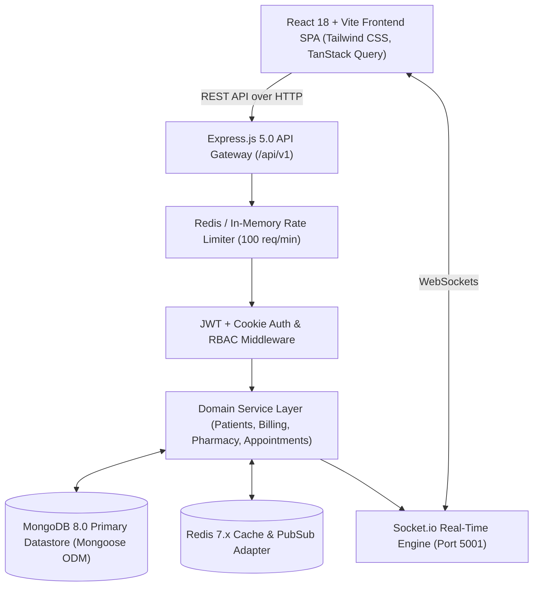

# PulseCare Hospital Management System (HMS)
## Technical Architecture & Source Code Quality Audit

- **Audit Date**: October 2026
- **Auditor Role**: Senior Software Architect & Lead Security Reviewer
- **Target Codebase**: `pulsecare-hms` (Node.js/TypeScript Express backend + React 18/Vite frontend)

---

### 1. Architectural Topology & Component Overview

PulseCare HMS is structured as a decoupled client-server web application adhering to a 3-tier architectural model:



#### Layer Breakdown:
1. **Frontend Presentation Layer (`frontend/`)**:
   - React 18 single-page application built with Vite and TypeScript.
   - Client-side routing via React Router DOM v6 (`frontend/src/App.tsx`).
   - State management split between Redux Toolkit (auth slice) and TanStack React Query v5 (server state).
   - Form handling using React Hook Form paired with Zod schema validation.
2. **Backend Application Layer (`backend/`)**:
   - Express 5.0 REST API with strict TypeScript compilation.
   - Modular domain architecture partitioned into 10 domain folders (`src/modules/*`).
   - Unified API response wrapping (`{ success: true, data: T, meta?: TMeta }`).
   - Centralized error interception and Winston structured JSON request logging.
3. **Persistence & Caching Layer**:
   - MongoDB 8.0 with Mongoose 8.0 ODM schemas, compound indexes, and pre-save lifecycle hooks.
   - Atomic counter sequence generation (`Counter` model) replacing autoincrement primary keys.
   - Redis 7.x integration for distributed rate limiting and Socket.io cluster synchronization.

---

### 2. End-to-End Workflow Tracing

#### Workflow A: Patient Registration & Profile Generation
- **Frontend Action**: Front-desk clerk completes `PatientRegistrationForm.tsx`, submitting demographic and emergency contact details.
- **Network Request**: `POST /api/v1/patients` with JSON payload.
- **Middleware Chain**:
  1. `rateLimiter.ts`: Validates request IP against rate window.
  2. `authenticate.ts`: Decodes JWT Bearer token, populates `req.user`.
  3. `authorize.ts`: Verifies role in `['admin', 'receptionist']`.
- **Validation**: `CreatePatientSchema.safeParse(req.body)` parses required fields, phone formatting, and blood group enum.
- **Service Logic (`patients/service.ts:28-69`)**:
  - Checks for duplicate email in `User` collection.
  - Creates `User` document with role `'patient'`.
  - Creates `Patient` document with auto-generated sequential ID (`PAT-0001` via `Counter.nextSequence`).
  - *Defect Identified*: If patient document creation fails, code executes `User.findByIdAndDelete(user._id)` in a catch block rather than using an atomic multi-document transaction session.
- **Response**: Returns HTTP 201 with populated patient and user objects.

#### Workflow B: Outpatient Appointment Booking & Queue Allocation
- **Frontend Action**: Receptionist or patient selects doctor, date, and available time slot in `BookAppointmentModal.tsx`.
- **Network Request**: `POST /api/v1/appointments`.
- **Service Logic (`appointments/service.ts:35-110`)**:
  - Checks if appointment date is in the past (`new Date(date) < today`).
  - Verifies doctor exists, is active, and is not on leave during the requested date (`Doctor.leaves.some(...)`).
  - Validates that requested time slot falls within the doctor's weekly working schedule (`doctor.availability`).
  - Checks for double-booking collision: `Appointment.findOne({ doctor: doctorId, date, timeSlot, status: { $ne: 'cancelled' } })`. Throws HTTP 409 if slot is taken.
  - Computes daily sequential queue token for the doctor on that date via atomic MongoDB counter.
  - Persists appointment with `APT-XXXX` ID and status `'scheduled'`.
- **Response**: Returns HTTP 201 with appointment ID and token number.

#### Workflow C: Prescription Dispensing & Pharmacy Stock Deduction
- **Frontend Action**: Nurse views active prescription in `PharmacyDispenseModal.tsx` and clicks "Dispense".
- **Network Request**: `PATCH /api/v1/pharmacy/prescriptions/:id/dispense`.
- **Middleware Chain**: Verifies `role === 'nurse'` or `'admin'`.
- **Service Logic (`pharmacy/service.ts:220-262`)**:
  - Asserts prescription is in `'active'` status.
  - Iterates over `prescription.lineItems` array:
    ```typescript
    const updated = await Drug.findOneAndUpdate(
      { _id: item.drugId, stockQuantity: { $gte: deductQty } },
      { $inc: { stockQuantity: -deductQty } },
      { new: true }
    );
    ```
  - If stock is insufficient, throws `ValidationError` (`HTTP 400`).
  - If stock drops below `reorderLevel`, triggers `emitToRole('admin', 'pharmacy:low-stock', ...)`.
  - Sets prescription status to `'dispensed'`.
- **Critical Architectural Flaw**: **Lack of Transaction Atomicity**. If a prescription has Drug A (available) and Drug B (out of stock), Drug A is decremented before Drug B throws an error. The database is left with permanently reduced Drug A stock, while the prescription remains undispensed.

---

### 3. Deep-Dive Codebase Findings & Path-Level Deficiencies

#### A. Incomplete MongoDB Transaction Handling
- **File**: `backend/src/modules/patients/service.ts:35`
- **Code Inspection**:
  ```typescript
  // NOTE: Not using Mongoose sessions/transactions here for single-instance compatibility.
  // In a production multi-replica environment, wrap these in a session transaction.
  const user = await User.create(...);
  try {
    patient = await Patient.create(...);
  } catch (err) {
    await User.findByIdAndDelete(user._id);
    throw err;
  }
  ```
- **Finding**: Multi-document operations rely on manual pseudo-rollback (`findByIdAndDelete`) instead of native MongoDB transactions (`mongoose.startSession()`). If the Node.js process crashes between `User.create` and `Patient.create`, orphaned User records accumulate in the database.

#### B. Flawed Duplicate Key Error Identification in Error Middleware
- **File**: `backend/src/middleware/errorHandler.ts:66`
- **Code Inspection**:
  ```typescript
  // Mongoose duplicate key
  if ('code' in err && (err as NodeJS.ErrnoException).code === '11000') {
    res.status(409).json(errorResponse('DUPLICATE_KEY', 'Resource already exists'));
    return;
  }
  ```
- **Finding**: In the MongoDB driver / Mongoose, `err.code` is a numeric primitive (`11000`), not a string (`'11000'`). Because of strict equality `===`, this check always evaluates to `false`. Every duplicate key violation falls through to line 72, returning HTTP 500 `INTERNAL_ERROR` with stack trace logging instead of HTTP 409 `DUPLICATE_KEY`.

#### C. Rate Limiter Memory Leak & Test Interference
- **File**: `backend/src/middleware/rateLimiter.ts:23-50`
- **Code Inspection**:
  ```typescript
  const memoryStore = new Map<string, MemoryRateRecord>();
  export function checkMemoryRateLimit(identifier: string, ...): number {
    ...
  }
  ```
- **Finding**: The in-memory rate limiter lacks an environment check (`process.env.NODE_ENV === 'test'`). When executing full test suites with Jest, all requests originate from `127.0.0.1`. The counter rapidly hits 100 requests within 60 seconds, causing subsequent tests (such as `lab.test.ts`) to be rejected with HTTP 429 and fail auth token generation.

#### D. Revenue Aggregation Inversion in Analytics
- **File**: `backend/src/modules/analytics/service.ts:106-119`
- **Code Inspection**:
  ```typescript
  Invoice.aggregate([
    { $match: { status: { $in: ['paid', 'partial'] } } },
    {
      $group: {
        _id: { $dateToString: { format: '%Y-%m', date: '$issuedDate' } },
        revenue: { $sum: '$total' }, // <--- CRITICAL BUG
        count: { $sum: 1 },
      },
    },
  ])
  ```
- **Finding**: For invoices in `'partial'` status, `$sum: '$total'` adds the full invoiced amount rather than the actual cash amount received (`$amountPaid`). If a patient pays ₹500 on a ₹5,000 invoice, the system adds ₹5,000 to revenue and ₹4,500 to outstanding balances, falsifying total assets.

#### E. Dead Code & Legacy JSX Artifacts in Frontend
- **Directory**: `frontend/src/components/Admin/` and `frontend/src/components/Profile/`
- **Findings**:
  - The frontend has migrated to TypeScript (`.tsx`), but 12 legacy `.jsx` files remain in the repository:
    - `frontend/src/components/Admin/DoctorModal.jsx`
    - `frontend/src/components/Admin/DepartmentModal.jsx`
    - `frontend/src/components/Admin/StaffList.jsx`
    - `frontend/src/components/Profile/PatientProfileModal.jsx`
  - These files are completely unreferenced by `App.tsx` or modern router views, representing orphaned legacy code from earlier development iterations.

#### F. Inconsistent Response Schemas in Staff Module
- **File**: `backend/src/modules/staff/controller.ts:45`
- **Finding**: Certain endpoints in the staff module return raw Mongoose documents directly rather than wrapping them in the standardized `successResponse()` structure defined in `backend/src/types/api.ts`. This causes frontend API interceptors to occasionally fail on `res.data.data` destructuring.

---

### 4. Database Schema Integrity & Constraint Audit

| Model | Primary Key | Critical Indexes | Cascade / Referential Integrity | Audit Verdict |
| :--- | :--- | :--- | :--- | :--- |
| **`User`** | `_id` (ObjectId) | `email: 1 (unique)` | Soft delete (`isActive: false`) | **PASS** |
| **`Patient`** | `patientId` (PAT-XXXX) | `patientId: 1 (unique)`, `userId: 1` | Cascade cleanup in controller | **PASS** |
| **`Doctor`** | `doctorId` (DOC-XXXX) | `doctorId: 1 (unique)`, `userId: 1` | Referenced by appointments | **PASS** |
| **`Appointment`** | `appointmentId` (APT-XXXX) | `{ doctor: 1, date: 1, timeSlot: 1 }` | Compound index prevents double bookings | **PASS** |
| **`Invoice`** | `invoiceId` (INV-XXXX) | `invoiceId: 1 (unique)`, `{ patient: 1, status: 1 }` | Readonly financial fields enforced pre-save | **PASS** |
| **`Drug`** | `code` (string) | `code: 1 (unique)`, `name: 1` | Checked on dispensing | **PASS** |
| **`StockMovement`** | `_id` (ObjectId) | `itemId: 1, createdAt: -1` | Used in Inventory, omitted in Pharmacy | **PARTIAL** |
| **`LabOrder`** | `orderId` (LAB-XXXX) | `orderId: 1 (unique)`, `patientId: 1` | Status state machine enforced | **PASS** |
| **`AuditLog`** | `_id` (ObjectId) | `userId: 1, timestamp: -1` | Immutable audit trail | **PASS** |
