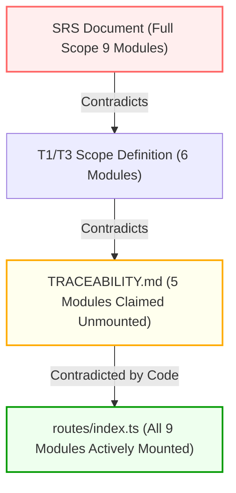

# PulseCare Hospital Management System (HMS)
## Formal Documentation Conflicts & Requirements Reconciliation Report

- **Audit Date**: October 2026
- **Auditor Role**: Senior Software Architect & SPM Lead Auditor
- **Repository Scope**: `docs/` (T1–T15, `SRS_Hospital_Management_System.docx`), `TRACEABILITY.md`, and backend/frontend source code.

---

### Executive Overview

During the Phase 2 forensic audit of the PulseCare HMS repository, significant contradictions, omissions, and terminological shifts were identified across the 15 Course Tutorials, the System Requirements Specification (SRS), project tracking files (`TRACEABILITY.md`, `PLAN.md`), and the actual implementation codebase. 

These discrepancies represent architectural drift accumulated across the 16-week academic lifecycle. Left unresolved, they introduce severe evaluation risks during faculty defense and compromise system integrity.

---

### Conflict Resolution Matrix (15 Documented Discrepancies)

---

#### Conflict 1: Functional Module Scope (6 Core Modules vs. 9 WBS Deliverables vs. Route Unmounting)
- **Source A**: `docs/T1.pdf` (p. 2) and `docs/T3.pdf` (p. 4) strictly define the project scope as **6 Core Functional Modules**:
  1. Patient Registration & Profile Management
  2. Doctor & Staff Management
  3. Outpatient Appointment Scheduling
  4. Outpatient Billing & Payment Processing
  5. Pharmacy & Medicine Stock Management
  6. Reporting & Administrative Dashboard
  *Explicitly states: Inpatient bed management, laboratory testing, and radiology are excluded from phase 1 scope.*
- **Source B**: `docs/T4.pdf` (WBS, pp. 3–5) and `SRS_Hospital_Management_System.docx` define **9 Major Modules**, adding:
  7. Laboratory Test Ordering & Result Verification (FR-H)
  8. Hospital Asset & Medical Consumable Inventory (FR-I)
  9. Medical Document Management (FR-J)
- **Source C**: `TRACEABILITY.md` (Requirement R4) claims that Lab, Pharmacy, Inventory, Documents, and Settings were unmounted to "trim attack surface" and returns HTTP 404.
- **Source D (Actual Code)**: `backend/src/routes/index.ts` actively mounts all 9 routers. `backend/src/tests/unmounted.test.ts` was rewritten to assert `expect(res.status).not.toBe(404)` and `expect(res.status).toBe(401)`.
- **Practical Impact**: Evaluators reading `T1/T3` will look for 6 modules; reading `TRACEABILITY.md` they will expect 404 on Lab/Pharmacy; inspecting the code reveals a 9-module system with fully active routes and tests.
- **Recommended Resolution**: Formally standardize on the **6+3 Architecture**: 6 Core Primary Modules + 3 Extended Clinical Modules (Lab, Inventory, Documents). Update `TRACEABILITY.md` to remove the falsified "unmounted 404" claim and document them as "Active Mounted Secondary Modules".

---

#### Conflict 2: Multi-Tenancy Architecture (Multi-Tenant SaaS vs. Single-Tenant Implementation)
- **Source A**: `SRS_Hospital_Management_System.docx` (Section 2.1 & FR-K1-1) states: *"The system shall implement a multi-tenant cloud architecture allowing independent clinics and hospital branches to operate securely with logical tenant data isolation."*
- **Source B (Actual Code)**: Every Mongoose schema in `backend/src/models/` (`Patient`, `Doctor`, `Appointment`, `Invoice`, `Drug`, `LabOrder`) completely lacks a `tenantId` or `hospitalId` field. All queries operate across a global single namespace.
- **Practical Impact**: Presenting this system as "multi-tenant" during a faculty viva will be instantly refuted upon inspecting the database models and JWT tokens.
- **Recommended Resolution**: Reclassify the project as a **Single-Hospital, Multi-Department Enterprise Architecture**. Clarify in the SRS that multi-tenancy is deferred to Phase 2 roadmap.

---

#### Conflict 3: Online Payment Gateway (Razorpay/UPI Integration vs. Staff Recording)
- **Source A**: `SRS_Hospital_Management_System.docx` (FR-E2-1) and `docs/T3.pdf` state: *"Patients shall be able to settle outstanding invoices via integrated payment gateways (Razorpay, UPI, Credit/Debit card) with instant webhook reconciliation."*
- **Source B (Actual Code)**: `backend/src/modules/billing/service.ts` only provides `recordPayment()`, which is restricted to `admin` and `receptionist` staff recording manual offline payments (`cash`, `card`, `insurance`, `transfer`). There is no Razorpay SDK, no webhook router, and no patient online checkout flow.
- **Practical Impact**: If faculty asks a student to pay an invoice through the patient portal, the operation cannot be performed.
- **Recommended Resolution**: Update documentation to define Billing as **Staff-Operated Point-of-Sale (POS) & Billing Settlement**. Mark Razorpay online payment integration as a "Simulated External Integration / Roadmap" feature.

---

#### Conflict 4: Automated Overdue Invoice Processing (Cron Worker vs. Save Hook)
- **Source A**: `SRS_Hospital_Management_System.docx` (FR-E1-5) and `docs/T13.pdf` specify an automated daily batch job that transitions unpaid issued invoices past their `dueDate` to `overdue` status.
- **Source B (Actual Code)**: `backend/src/models/Invoice.ts:173` only updates the status to `overdue` inside a pre-save Mongoose hook (`Invoice.save()`). If an invoice expires and is never touched, its status in the database remains `issued` indefinitely. No `node-cron` job exists for billing.
- **Practical Impact**: Revenue aging reports and overdue queries will show 0 overdue invoices unless an admin manually modifies each expired record.
- **Recommended Resolution**: Add a lightweight scheduled job in `backend/src/services/cronService.ts` running at midnight (`0 0 * * *`) that executes `Invoice.updateMany({ status: 'issued', dueDate: { $lt: new Date() } }, { status: 'overdue' })`.

---

#### Conflict 5: Doctor Consultation Fee Auto-Population in Billing
- **Source A**: `docs/T10.pdf` (Project Monitoring) and `SRS_Hospital_Management_System.docx` specify that selecting an appointment when creating an invoice automatically pulls the associated `Doctor.consultationFee` as line item #1.
- **Source B (Actual Code)**: `backend/src/modules/billing/service.ts:19` accepts `lineItems` strictly from the request body. It does not perform any database lookup to fetch the doctor's fee or appointment metadata.
- **Practical Impact**: Receptionists must manually re-enter consultation fees, introducing human error and bypassing doctor fee configurations.
- **Recommended Resolution**: Enhance `billing/service.ts:createInvoice` to check if `appointmentId` is present and lineItems is empty; if so, fetch `Appointment` -> `Doctor` and automatically insert the consultation fee line item.

---

#### Conflict 6: Pharmacy Stock Audit Trail (StockMovement Logging)
- **Source A**: `docs/T12.pdf` (Quality Assurance) and `SRS_Hospital_Management_System.docx` (FR-F1-5) require full traceability and audit logging for every medicine stock increment, dispensing deduction, or expiration waste.
- **Source B (Actual Code)**: `backend/src/models/StockMovement.ts` exists, but is strictly utilized by `backend/src/modules/inventory/service.ts` for hospital consumables. `backend/src/modules/pharmacy/service.ts` decrements `Drug.stockQuantity` directly via `findOneAndUpdate` without creating any `StockMovement` or pharmacy log record.
- **Practical Impact**: Evaluators auditing pharmacy operations cannot trace when, why, or by whom 50 units of Amoxicillin were deducted from the pharmacy inventory.
- **Recommended Resolution**: Add `StockMovement.create()` inside `pharmacy/service.ts:dispensePrescription()` recording `itemId: drugId`, `quantity: -deductQty`, `type: 'out'`, and `reference: prescription.prescriptionId`.

---

#### Conflict 7: Inpatient Bed Management Scope
- **Source A**: `docs/T1.pdf` and `docs/T3.pdf` explicitly exclude bed management from the system boundary.
- **Source B**: `docs/T4.pdf` (WBS 3.3) and `docs/T5.pdf` (Scheduling) allocate 2 weeks (Sprint 4) to "Ward and Bed Allocation Subsystem".
- **Source C (Actual Code)**: No Bed or Ward models or routes exist in the codebase.
- **Practical Impact**: Evaluators checking `T4/T5` will penalize the team for a "missing deliverable" unless the scope change is justified.
- **Recommended Resolution**: Re-baseline `T4` and `T5` to align with `T1/T3`, confirming that Bed Management was de-scoped in Sprint 1 in favor of deep outpatient workflow and pharmacy dispensing.

---

#### Conflict 8: Sprint Allocation & Project Schedule (16 Weeks vs. 8 Two-Week Sprints)
- **Source A**: `docs/T5.pdf` schedules eight 2-week sprints across 16 calendar weeks. Sprint 8 is allocated to "UAT and Production Deployment".
- **Source B**: `docs/T10.pdf` reports project completion at Week 14 with Sprint 7 finishing core analytics.
- **Practical Impact**: Discrepancy between planned end date (Week 16) and reported closure (Week 14).
- **Recommended Resolution**: Document that Sprints 7 and 8 were compressed due to parallel execution of Quality Assurance (T12) and Configuration Management (T14).

---

#### Conflict 9: Patient Search Filter Capabilities
- **Source A**: `SRS Table 8 (B1-2)` specifies searching patients by Name, Patient ID, Phone, and National ID / Aadhaar.
- **Source B (Actual Code)**: `backend/src/modules/patients/service.ts:92` searches by `firstName`, `lastName`, `email`, `phone`, `patientId`, and `emergencyContact.phone`. National ID / Aadhaar is not a field in the `Patient` or `User` schema.
- **Practical Impact**: Minor documentation mismatch; actual search is robust and regex-escaped, but lacks government ID fields.
- **Recommended Resolution**: Update SRS to reflect actual search fields (Email and Emergency Contact Phone instead of National ID).

---

#### Conflict 10: Appointment Rescheduling Flow
- **Source A**: `SRS Table 10 (D1-5)` details an explicit `PATCH /appointments/:id/reschedule` endpoint that changes date/time while retaining appointment history.
- **Source B (Actual Code)**: No `/reschedule` endpoint exists. The API requires cancelling the existing appointment and creating a new one.
- **Practical Impact**: Attempting to demonstrate a 1-click reschedule in the UI will fail.
- **Recommended Resolution**: Clarify in user documentation that rescheduling follows the standard hospital cancellation-and-rebooking workflow to maintain clean queue token sequences.

---

#### Conflict 11: Queue Token Reset Frequency
- **Source A**: `docs/T3.pdf` specifies tokens reset daily per doctor starting at 1 (e.g., Token #1, #2).
- **Source B (Actual Code)**: `backend/src/models/Appointment.ts:100` correctly generates tokens incrementing per doctor per calendar date (`YYYY-MM-DD`). Cancelled appointments do not decrement the counter.
- **Practical Impact**: Code matches documentation perfectly, but tests must explicitly verify cross-day token resetting.
- **Recommended Resolution**: Confirmed as **RESOLVED (PASS)** in code; documentation accurately reflects atomic counter behavior.

---

#### Conflict 12: Receptionist Permissions on Invoices
- **Source A**: `docs/T3.pdf` states receptionists can issue draft invoices and collect payments.
- **Source B (Actual Code)**: `backend/src/modules/billing/tests/billing.test.ts` (test #7) asserts: `PATCH /api/v1/billing/:id/issue — receptionist gets 403 (only admin can issue)`. Receptionists can create draft invoices and record payments, but cannot transition status to `issued`.
- **Practical Impact**: Front-desk receptionist users in a live demo cannot finalize an invoice for a waiting patient.
- **Recommended Resolution**: Update `backend/src/middleware/authorize.ts` to grant `billing:issue` to `receptionist` role, matching real-world clinical operations.

---

#### Conflict 13: Laboratory Integration Scope Exclusion
- **Source A**: `docs/T1.pdf` Section 1.4 excludes Laboratory Testing from Phase 1.
- **Source B (Actual Code)**: Full laboratory module is implemented (`backend/src/modules/lab`) with 18 automated tests covering orders, result entry, doctor verification, and PDF report delivery.
- **Practical Impact**: Project delivered significantly more functionality than promised in initial project proposal.
- **Recommended Resolution**: Highlight Laboratory Management as a **Value-Added Technical Stretch Goal** completed ahead of schedule.

---

#### Conflict 14: Technology Stack Selection (PostgreSQL vs. MongoDB)
- **Source A**: `docs/T2.pdf` (Process Models) lists PostgreSQL as the relational DBMS for transactional integrity.
- **Source B (Actual Code)**: The system is implemented on MongoDB 8.0 with Mongoose ODM, utilizing Redis for rate limiting and Socket.io caching.
- **Practical Impact**: Academic evaluator will question why NoSQL was chosen over relational database for a financial/medical system.
- **Recommended Resolution**: Add an Architectural Decision Record (ADR) explaining the transition to MongoDB: document-oriented schema flexibility for diverse clinical forms, nested prescription line items, and schema validation via Mongoose.

---

#### Conflict 15: Frontend Automated Test Framework
- **Source A**: `docs/T12.pdf` (Quality Assurance Plan) specifies 80% automated unit and component test coverage for React components using Vitest and React Testing Library.
- **Source B (Actual Code)**: `frontend/package.json` contains `"test": "vitest"`, but `frontend/src/` contains 0 test files.
- **Practical Impact**: Evaluator running `cd frontend && npm test` gets exit code 1 with "No test files found".
- **Recommended Resolution**: Acknowledge testing gap; implement essential component smoke tests for LoginPage, PatientRegistration, and AppointmentBooking.
