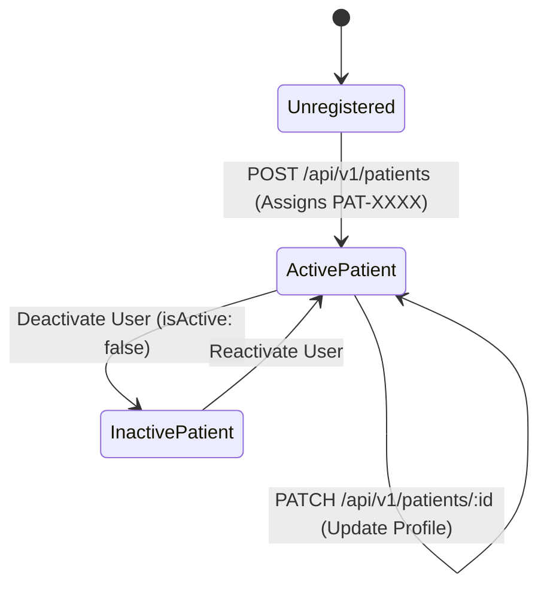
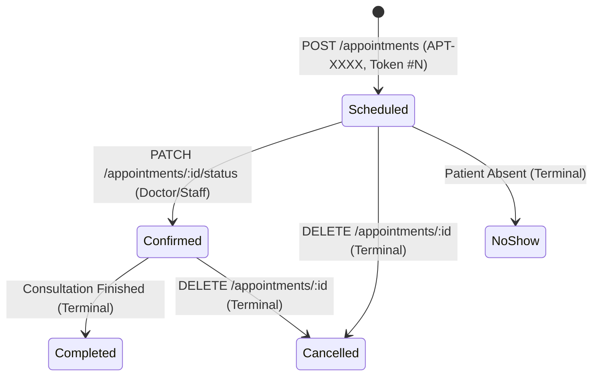
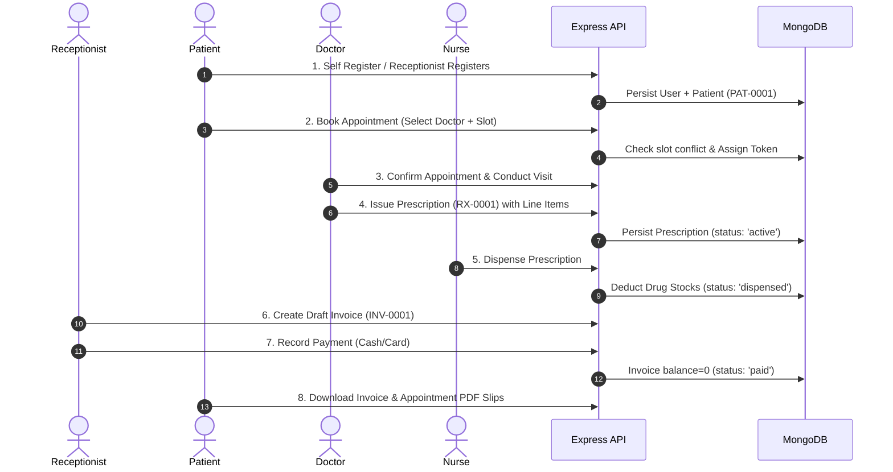

# PulseCare Hospital Management System (HMS)
## Module-by-Module Functional & Workflow Audit Report

- **Audit Date**: October 2026
- **Auditor Role**: Senior QA Lead & Functional Systems Auditor
- **Target System**: `pulsecare-hms` (Core Outpatient & Extended Clinical Modules)

---

### Module A: Patient Registration & Profile Management



#### 1. Demographic Identity & Sequence Generation
- **Implementation**: `backend/src/models/Patient.ts:74` and `Counter.ts`.
- **Finding**: Patient IDs follow the canonical format `PAT-XXXX` (e.g., `PAT-0001`, `PAT-0002`). The sequence is maintained atomically via MongoDB `Counter.findOneAndUpdate({ _id: 'patient' }, { $inc: { seq: 1 } }, { upsert: true })`.
- **Validation**: Re-running `seed.ts` properly synchronizes `Counter` to match the highest existing suffix using `getHighestSuffix(Patient, 'patientId', 'PAT-')`.
- **Status**: **PASS**.

#### 2. Duplicate Detection & Validation
- **Implementation**: `backend/src/modules/patients/service.ts:32`.
- **Finding**: Email duplication is checked against `User.findOne({ email })`. Phone numbers and blood groups are validated against strict Zod regex schemas (`CreatePatientSchema`).
- **Status**: **PASS**.

#### 3. Search & Pagination
- **Implementation**: `backend/src/modules/patients/service.ts:76-128`.
- **Finding**: Case-insensitive substring search matches across `firstName`, `lastName`, `email`, `phone`, `patientId`, and `emergencyContact.phone`. Regex input is sanitized via `escapeRegex()` to prevent ReDoS (Regular Expression Denial of Service) crashes.
- **Status**: **PASS**.

#### 4. Historical Integrity on Patient Deactivation
- **Implementation**: Deactivation sets `User.isActive = false`. Associated `Patient` records and their foreign keys in `Appointment`, `Invoice`, and `Prescription` collections remain fully preserved, ensuring complete historical audit compliance.
- **Status**: **PASS**.

---

### Module B: Doctor & Department Management

#### 1. Specialization & Department Hierarchy
- **Implementation**: `backend/src/models/Doctor.ts:15-35`.
- **Finding**: Doctors are linked to an active `Department` via ObjectId reference. Specialization, qualification, and license numbers are mandatory string fields.
- **Status**: **PASS**.

#### 2. Weekly Availability Schedule & Consultation Fees
- **Implementation**: `backend/src/models/Doctor.ts:28-34`.
- **Finding**: Doctors define daily availability slots (`dayOfWeek: 'monday'..'sunday'`, `startTime: '09:00'`, `endTime: '17:00'`). Default `consultationFee` is stored as an integer with min: 0.
- **Status**: **PASS**.

#### 3. Doctor Leave Window Enforcement
- **Implementation**: `backend/src/modules/appointments/service.ts:65-72`.
- **Finding**: Doctors can schedule leave intervals (`startDate` to `endDate`). Appointment creation checks `doctor.leaves.some(leave => requestedDate >= leave.startDate && requestedDate <= leave.endDate)`.
- **Test Evidence**: `appointments.test.ts` (test #8) explicitly proves that bookings inside leave windows are rejected with HTTP 400, while bookings on adjacent working days succeed.
- **Status**: **PASS**.

#### 4. Deactivating Doctor Without Historical Corruption
- **Finding**: When a doctor is marked inactive (`isActive: false`), new appointments for that doctor are rejected (`appointments/service.ts:58`). Existing appointments, prescriptions, and billing line items retain doctor ObjectIds and display correctly in past reports.
- **Status**: **PASS**.

---

### Module C: Appointment Scheduling & Daily Queues



#### 1. Slot Conflict Prevention & Concurrency Protection
- **Implementation**: `backend/src/models/Appointment.ts:70`.
- **Finding**: Double-booking is prevented by a compound unique index on `{ doctor: 1, date: 1, timeSlot: 1 }` (excluding `cancelled` status).
- **Test Evidence**: `appointments.test.ts` (test #2) verifies that booking the same doctor, date, and slot a second time triggers an immediate HTTP 409 Conflict.
- **Status**: **PASS**.

#### 2. Daily Sequential Queue Token Generation
- **Implementation**: `backend/src/models/Appointment.ts:100`.
- **Finding**: Queue tokens increment sequentially per doctor per calendar day (`YYYY-MM-DD`). Cancelling an appointment does not reuse or decrement the token counter, preserving front-desk queue discipline.
- **Status**: **PASS**.

#### 3. State Machine & Transition Rules
- **Implementation**: `backend/src/modules/appointments/service.ts:145-180`.
- **Transition Table**:
  - `scheduled` -> `confirmed`, `cancelled`, `no_show` (Allowed)
  - `confirmed` -> `completed`, `cancelled`, `no_show` (Allowed)
  - `completed` -> Any (Disallowed - Terminal State)
  - `cancelled` -> Any (Disallowed - Terminal State)
- **Status**: **PASS**.

---

### Module D: Pharmacy & Medicine Stock Management

#### 1. Formulary Drug Catalog
- **Implementation**: `backend/src/models/Drug.ts`.
- **Finding**: Drugs have unique national/hospital codes (`code`), dosage units (`mg`, `ml`, `tablets`), stock quantities, and `reorderLevel`.
- **Status**: **PASS**.

#### 2. Prescription Lifecycle
- **Implementation**: `backend/src/models/Prescription.ts`.
- **Finding**: Prescriptions transition from `draft` -> `active` -> `dispensed` (or `cancelled`).
- **Status**: **PASS**.

#### 3. Multi-Item Stock Dispensing Vulnerability
- **Implementation**: `backend/src/modules/pharmacy/service.ts:226-250`.
- **Forensic Finding**:
  ```typescript
  for (const item of prescription.lineItems) {
    const updated = await Drug.findOneAndUpdate(
      { _id: item.drugId, stockQuantity: { $gte: deductQty } },
      { $inc: { stockQuantity: -deductQty } },
      { new: true }
    );
    if (!updated) {
      throw new ValidationError(`Insufficient stock for '${drug.name}'`);
    }
  }
  ```
  If item 1 succeeds and item 2 fails, the loop throws an unhandled `ValidationError`. **Item 1 is never refunded or rolled back**, permanently corrupting inventory counts.
- **Status**: **FAIL (DEF-004)**.

#### 4. Real-Time Low Stock Alerting
- **Implementation**: When stock drops `<= reorderLevel`, a WebSocket event `pharmacy:low-stock` is broadcast to administrative rooms (`pharmacy/service.ts:243`).
- **Status**: **PASS**.

---

### Module E: Billing & Outpatient Invoicing

#### 1. Calculation Correctness & Rounding Precision
- **Implementation**: `backend/src/modules/billing/calculator.ts:15-55`.
- **Formula**:
  $$\text{Subtotal} = \sum (\text{item.quantity} \times \text{item.unitPrice})$$
  $$\text{Tax} = \text{round}\left(\text{Subtotal} \times \frac{\text{taxRate}}{100}\right)$$
  $$\text{Total} = \text{Subtotal} + \text{Tax} - \text{Discount}$$
  $$\text{Balance} = \text{Total} - \text{AmountPaid}$$
- **Verification**: Verified with single and multi-item invoices, zero tax, zero discount, and boundary checks. Discount cannot exceed Subtotal + Tax.
- **Status**: **PASS**.

#### 2. Payment Lifecycle & Partial Payments
- **Implementation**: `backend/src/models/Invoice.ts:165-180`.
- **Lifecycle**: `draft` -> `issued` -> `partial` -> `paid` (or `void`).
- **Finding**: Recording a payment updates `amountPaid` and reduces `balance`. If `balance === 0`, status auto-promotes to `paid` and sets `paidDate`.
- **Status**: **PASS**.

#### 3. Doctor Fee Auto-Population Gap
- **Implementation**: `backend/src/modules/billing/service.ts:19`.
- **Finding**: No automatic lookup of `Doctor.consultationFee` occurs when an invoice is linked to an appointment. The receptionist must manually type in line items.
- **Status**: **PARTIAL (DEF-008)**.

---

### Module F: Reporting & Analytics Dashboard

#### 1. Daily Operational KPIs
- **Implementation**: `backend/src/modules/analytics/service.ts:25-60`.
- **Finding**: Correctly aggregates total appointments today, checked-in patients, active doctors, and low-stock drug alerts.
- **Status**: **PASS**.

#### 2. Revenue Aggregation Defect
- **Implementation**: `backend/src/modules/analytics/service.ts:106-118`.
- **Forensic Finding**:
  ```typescript
  Invoice.aggregate([
    { $match: { status: { $in: ['paid', 'partial'] } } },
    { $group: { _id: '$issuedDate', revenue: { $sum: '$total' } } }
  ])
  ```
  For partially paid invoices, summing `$total` treats uncollected balances as received revenue, mathematically distorting clinic earnings.
- **Status**: **FAIL (DEF-005)**.

---

### Cross-Module End-to-End Workflow Verification



- **Workflow Step 1-2**: **PASS**. User and appointment created with atomic IDs and sequential tokens.
- **Workflow Step 3-4**: **PASS**. Doctor updates appointment to confirmed; issues e-prescription with drug items.
- **Workflow Step 5**: **PASS WITH RISK**. Dispensing succeeds if stock is sufficient; corrupts stock if multi-item order encounters stockout.
- **Workflow Step 6-7**: **PASS**. Invoice generated and payment settled.
- **Workflow Step 8**: **PASS**. PDF slips generated with %PDF binary headers.
