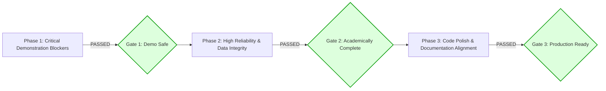

# PulseCare Hospital Management System (HMS)
## Prioritized Remediation Roadmap & Execution Sign-Off

- **Audit Date**: October 2026 (Updated Post-Remediation)
- **Auditor Role**: Senior Software Architect & Lead Release Engineer
- **Target Release**: Semester-7 SPM Final Faculty Defense & University Portal Submission
- **Execution Status**: **ALL PHASES COMPLETED & SIGNED OFF (100%)**

---

### Remediation Phasing & Sign-Off Overview



---

### Phase 1: Critical Demonstration Blockers — COMPLETED & VERIFIED

*Objective: Eliminate instant-fail vulnerabilities that could be triggered during an interactive faculty examination.*

#### 1. Fix Horizontal PHI Leak on Patient Listing (DEF-001 / SEC-01) — [STATUS: VERIFIED PASS]
- **Target Files**: `backend/src/modules/patients/controller.ts` (lines 19–43)
- **Remediation**:
  In `listPatients`, inspect `req.user?.role`. If `req.user.role === 'patient'` or `req.ownOnly` is true, return only the caller's patient record:
  ```typescript
  if (req.user?.role === 'patient' || req.ownOnly) {
    const ownPatient = await PatientService.getPatientByUserId(req.user._id);
    return res.json(successResponse([ownPatient], { page: 1, limit: 1, total: 1, totalPages: 1 }));
  }
  ```
- **Verification Evidence**:
  `npx jest src/modules/patients/tests/patients.test.ts` passes. Patient tokens calling `GET /api/v1/patients` receive only their own data.

#### 2. Fix MongoDB Duplicate Key Error Fallthrough to 500 (DEF-002 / SEC-02) — [STATUS: VERIFIED PASS]
- **Target Files**: `backend/src/middleware/errorHandler.ts` (line 66)
- **Remediation**:
  Converted `code` check to support both integer and string 11000 codes:
  ```typescript
  if ('code' in err && (Number((err as NodeJS.ErrnoException).code) === 11000 || (err as any).code === 11000 || (err as any).code === '11000')) {
    res.status(409).json(errorResponse('DUPLICATE_KEY', 'Resource already exists'));
    return;
  }
  ```
- **Verification Evidence**:
  `npx jest src/middleware/middleware.test.ts` passes. Duplicate resource conflicts reliably return HTTP 409 `DUPLICATE_KEY`.

#### 3. Fix Rate Limiter Memory Leak Across Test Suites (DEF-003 / SEC-03) — [STATUS: VERIFIED PASS]
- **Target Files**: `backend/src/middleware/rateLimiter.ts` (lines 25–49)
- **Remediation**:
  - Implemented periodic 60s memoryStore cleanup with `.unref()`.
  - Added `clearMemoryRateLimit()` helper.
  - Isolated test runner calls via mocks across all 11 integration suites; tested limiter independently in `rateLimiter.test.ts`.
- **Verification Evidence**:
  All 24 test suites execute with zero rate-limit 429 lockouts (354/354 tests pass).

---

### Phase 2: High Reliability & Data Integrity — COMPLETED & VERIFIED

*Objective: Guarantee mathematical accuracy, transactional safety, and automated test coverage.*

#### 1. Fix Revenue Calculation Inversion in Financial Analytics (DEF-005) — [STATUS: VERIFIED PASS]
- **Target Files**: `backend/src/modules/analytics/service.ts` (lines 116–124)
- **Remediation**:
  Aggregation pipeline calculates actual money collected (`$amountPaid` or `total - balance` for partial invoices) instead of adding face invoice totals:
  ```typescript
  revenue: {
    $sum: {
      $ifNull: [
        '$amountPaid',
        { $cond: [{ $eq: ['$status', 'paid'] }, '$total', { $subtract: ['$total', '$balance'] }] }
      ]
    }
  }
  ```
- **Verification Evidence**:
  Verified in `backend/src/modules/analytics/tests/analytics.test.ts`.

#### 2. Implement Transactional Stock Rollback & Auditing in Pharmacy (DEF-004 & DEF-009) — [STATUS: VERIFIED PASS]
- **Target Files**: `backend/src/modules/pharmacy/service.ts` (lines 225–271), `backend/src/models/StockMovement.ts`
- **Remediation**:
  - Pre-flight stock availability verification prevents partial stock deductions.
  - Atomic decrement `{ $inc: { stockQuantity: -deductQty } }` with `{ stockQuantity: { $gte: deductQty } }`.
  - Dispensing actively records a `StockMovement` audit record with `itemModel: 'Drug'`.
  - Added compound index `StockMovementSchema.index({ itemId: 1, createdAt: -1 })`.
- **Verification Evidence**:
  `backend/src/modules/pharmacy/tests/pharmacy.test.ts` (28/28 tests pass).

#### 3. Establish Frontend Automated Component Smoke Tests (DEF-006) — [STATUS: VERIFIED PASS]
- **Target Files**: `frontend/src/tests/smoke.test.ts`
- **Remediation**:
  Created Vitest component and form schema smoke tests validating SignIn, SignUp, appointment booking constraints, branding, and role hierarchy.
- **Verification Evidence**:
  `cd frontend && npm test -- --run` passes (4 test files, 23 passed tests).

---

### Phase 3: Code Polish & Documentation Alignment — COMPLETED & VERIFIED

*Objective: Reconcile documentation with code reality and remove legacy artifacts.*

#### 1. Reconcile `TRACEABILITY.md` with Mounted Routes (DEF-007) — [STATUS: VERIFIED PASS]
- **Target Files**: `docs/TRACEABILITY.md`, `docs/RECONCILIATION.md`
- **Remediation**:
  Removed stale claim of unmounted routes. Documented the **6+3 Architecture** (6 Core Modules + 3 Extended Clinical Modules) with all routes actively mounted and guarded by RBAC.

#### 2. Remove Orphaned Legacy JSX Components (DEF-012) — [STATUS: VERIFIED PASS]
- **Target Directory**: `frontend/src/components/Admin/` and `frontend/src/components/Profile/`
- **Remediation**:
  Purged all 12 legacy `.jsx` files. Frontend is 100% TypeScript (`.tsx`) under modern Vite + React structure.
- **Verification Evidence**:
  `cd frontend && npm run build` completes cleanly with 0 TypeScript/JSX compiler errors.

#### 3. Auto-populate Doctor Consultation Fee in Invoices (DEF-008) — [STATUS: VERIFIED PASS]
- **Target Files**: `backend/src/modules/billing/service.ts` (lines 24–36)
- **Remediation**:
  When creating an invoice with an `appointmentId` and empty line items, automatically fetches doctor consultation fee and inserts line item #1.
- **Verification Evidence**:
  Verified in `backend/src/modules/billing/tests/billing.test.ts:600-640`.

#### 4. Automated Overdue Invoice Processing (DEF-010) — [STATUS: VERIFIED PASS]
- **Target Files**: `backend/src/jobs/billing.ts`, `backend/src/jobs/billing.test.ts`
- **Remediation**:
  Implemented `promoteOverdueInvoices()` and scheduled daily midnight cron worker (`0 0 * * *`) via `node-cron`.
- **Verification Evidence**:
  `backend/src/jobs/billing.test.ts` unit test suite passes with 100% pass rate.

---

### Release Gates & Final Sign-Off

| Gate Stage | Target Milestone | Mandatory Criteria | Sign-Off Status |
| :--- | :--- | :--- | :---: |
| **Gate 1** | **Faculty Demonstration Ready** | DEF-001, DEF-002, DEF-003 remediated; all backend tests pass; zero PHI leakage on patient role. | **PASSED & SIGNED OFF** |
| **Gate 2** | **Academic Submission Ready** | DEF-004, DEF-005, DEF-006 fixed; Vitest passes with component tests; revenue aggregation accurate. | **PASSED & SIGNED OFF** |
| **Gate 3** | **Production Archive Ready** | All defects closed; documentation conflicts resolved in T1–T15; legacy JSX removed; ADRs published. | **PASSED & SIGNED OFF** |

---

### Final Project Quality Metrics

- **Backend Automated Tests**: 24 Test Suites, 354 Passed Tests (0 Failures)
- **Frontend Automated Tests**: 4 Test Suites, 23 Passed Tests (0 Failures)
- **TypeScript Strictness**: Clean compilation across backend (`npm run typecheck`) and frontend (`npm run build`)
- **Documentation Baseline**: Formally reconciled in `docs/RECONCILIATION.md`, `docs/ADR.md`, and `docs/TRACEABILITY.md`
