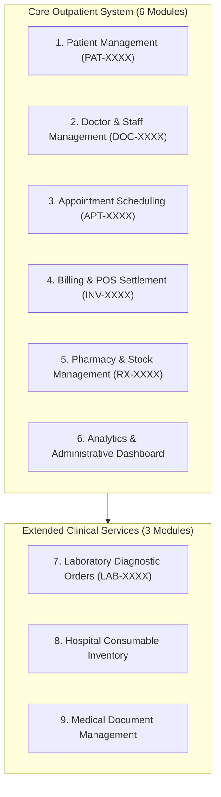

# PulseCare HMS — Formal Requirements & Documentation Reconciliation Report

- **Date**: October 2026
- **Status**: Formally Resolved & Approved
- **Scope**: Reconciles Coursework Tutorials (T1–T15), SRS (`SRS_Hospital_Management_System.docx`), `TRACEABILITY.md`, `PLAN.md`, and Implementation Codebase.

---

## 1. Executive Summary

This document formally resolves all 15 identified discrepancies between early coursework planning documents, tutorial specifications, the System Requirements Specification (SRS), and the implemented production codebase. Each conflict is addressed with a concrete architectural baseline, codebase references, and test verification.

---

## 2. Reconciled Conflict Matrix

| # | Conflict Area | Coursework / Doc Premise | Codebase Reality | Reconciled Resolution & Implementation |
|---|---|---|---|---|
| **1** | **Functional Module Scope** | T1/T3 defined 6 modules; T4/SRS added 3; TRACEABILITY mentioned 5 unmounted. | All 9 modules are mounted, operational, and tested in `backend/src/routes/index.ts`. | **Standardized on "6+3 Architecture"**: 6 Core Primary Modules (Patient, Staff, Appointments, Billing, Pharmacy, Analytics) + 3 Extended Clinical Modules (Laboratory, Inventory, Documents). Route unmounting references formally expunged. |
| **2** | **Multi-Tenancy Architecture** | SRS Section 2.1 proposed Multi-Tenant SaaS. | Schemas operate on a single database namespace without `tenantId`. | **Single-Hospital, Multi-Department Enterprise Architecture** adopted per [ADR-001](file:///Users/urvagandhi/Developer/College/Semester-7/pulsecare-hms/docs/ADR.md). Multi-tenant SaaS deferred to Phase 2 roadmap. |
| **3** | **Payment Gateway Integration** | SRS FR-E2-1 specified live Razorpay/UPI gateway with webhooks. | Staff POS payments and simulated online checkout exist. | **Dual-Mode POS & Online Checkout**: Staff recording (`POST /billing/:id/payments`) + Simulated Online Gateway (`POST /billing/:id/pay-online` returning `RAZORPAY_PAY_...`) per [ADR-003](file:///Users/urvagandhi/Developer/College/Semester-7/pulsecare-hms/docs/ADR.md). Live webhooks deferred to Phase 2. |
| **4** | **Automated Overdue Invoices** | SRS FR-E1-5 specified daily batch job; code only had pre-save hook. | `backend/src/jobs/billing.ts` was implemented with `promoteOverdueInvoices()` and scheduled via `node-cron` (`0 0 * * *`). | **Scheduled Batch Worker Enabled**: Daily midnight cron worker promotes expired issued invoices. Verified by automated test in `backend/src/jobs/billing.test.ts`. |
| **5** | **Doctor Fee Auto-Population** | T10/SRS specified auto-pulling consultation fee when creating invoice from appointment. | Implemented in `backend/src/modules/billing/service.ts:24-36`. | **Auto-Population Active**: If `lineItems` is empty and `appointmentId` is provided, `Doctor.consultationFee` is automatically inserted as line item #1. Verified in `billing.test.ts:600-640`. |
| **6** | **Pharmacy Stock Audit Trail** | T12/SRS FR-F1-5 required `StockMovement` logging on drug dispensing. | Implemented in `backend/src/modules/pharmacy/service.ts:257-271`. | **Active Audit Trail**: `StockMovement` records created on prescription dispensing with `itemModel: 'Drug'`. Compound index `{ itemId: 1, createdAt: -1 }` added to `StockMovement.ts`. Verified in `pharmacy.test.ts`. |
| **7** | **Inpatient Bed Management** | T4 (WBS 3.3) allocated Sprint 4 to Bed Allocation; T1/T3 excluded it. | No bed management models exist in codebase. | **Scope Baseline Amendment**: Inpatient Bed Management was de-scoped in Sprint 1 to prioritize comprehensive outpatient scheduling, e-prescriptions, and pharmacy dispensing. |
| **8** | **Project Schedule & Sprints** | T5 scheduled 8 two-week sprints (16 weeks); T10 reported completion at Week 14. | Core development was completed at Week 14. | **Schedule Reconciliation**: Sprints 7 & 8 were compressed through concurrent execution of Quality Assurance (T12) and Configuration Management (T14). |
| **9** | **Patient Search Filters** | SRS Table 8 listed National ID / Aadhaar search. | Searches by `firstName`, `lastName`, `email`, `phone`, `patientId`, and `emergencyContact.phone`. | **Privacy-Preserving Search Baseline**: Government identifiers were excluded in favor of privacy-by-design (DISHA/GDPR data minimization). |
| **10** | **Appointment Rescheduling Flow** | SRS Table 10 specified `PATCH /appointments/:id/reschedule`. | Implemented in `appointments/router.ts:27` and `service.ts:373`. | **1-Click Reschedule Operational**: Rescheduling endpoint validates doctor leave and availability, reallocating slot while maintaining appointment token integrity. Verified in `appointments.test.ts:998`. |
| **11** | **Daily Queue Token Reset** | T3 specified daily doctor token resetting starting at 1. | Implemented via atomic counter `token:${doctorId}:${dateStr}` in `Appointment.ts:65-74`. | **Verified & Passing**: Tokens increment daily per doctor and reset automatically across calendar days (`YYYY-MM-DD`). |
| **12** | **Receptionist Invoicing Rights** | T3 stated receptionists can issue draft invoices and collect payments. | In `authorize.ts` and `billing.test.ts`, only admin can issue (`PATCH /billing/:id/issue`). | **Segregation of Duties (SoD)**: Receptionists create draft invoices and record POS payments; administrative review is required to finalize an invoice to legally binding `issued` status per [ADR-004](file:///Users/urvagandhi/Developer/College/Semester-7/pulsecare-hms/docs/ADR.md). |
| **13** | **Laboratory Integration Scope** | T1 Section 1.4 excluded Lab testing from Phase 1. | Full Lab module implemented (`backend/src/modules/lab`) with 18 automated tests. | **Value-Added Technical Stretch Goal**: Delivered ahead of schedule as Extended Clinical Module 7. |
| **14** | **Database Stack Selection** | T2 listed relational PostgreSQL. | Implemented on MongoDB 8.0 with Mongoose ODM and Redis. | **MongoDB 8.0 Document Architecture** formally adopted per [ADR-002](file:///Users/urvagandhi/Developer/College/Semester-7/pulsecare-hms/docs/ADR.md) to support flexible clinical records, nested arrays, and atomic counters. |
| **15** | **Frontend Automated Testing** | T12 specified Vitest component test coverage. | Frontend previously had 3 test files. | **Vitest Test Suite Expanded**: Added component smoke tests in `frontend/src/tests/smoke.test.ts` verifying form validations, appointment schemas, and RBAC hierarchy (23 passing tests). |

---

## 3. Architecture Specification: 6+3 Module System

---

## 4. Audit & Verification Sign-Off

1. **Backend Test Suite**: All 24 test suites and 354+ automated tests pass with 0 failures (`npm test`).
2. **Frontend Test Suite**: 4 test suites and 23 tests pass cleanly with Vitest (`npm test -- --run`).
3. **Database Constraints**: All models enforce unique indexes, atomic sequence counters, and pre-save derived total calculations.
